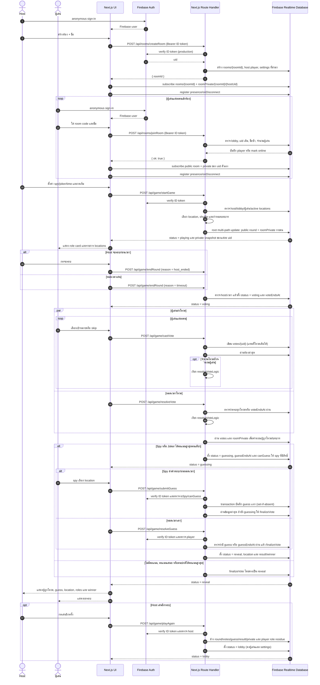

# Spyfall — Sequence Diagram

อัปเดตล่าสุด: 2026-10-24 อ้างอิง API และ UI ใน `app/` ปัจจุบัน

## หนึ่งรอบการเล่น



## ออกจากห้องและ cleanup

```mermaid
sequenceDiagram
    actor Player as Player
    participant UI as Next.js UI
    participant API as Next.js Route Handler
    participant RTDB as Firebase Realtime Database

    Player->>UI: ยืนยันออกจากห้อง
    UI->>API: POST /api/rooms/leaveRoom (Bearer ID token)
    API->>RTDB: ตรวจ membership
    alt ผู้เรียกเป็น host หรือไม่มีผู้เล่นอื่น online
        API->>RTDB: ลบ rooms/{roomId}, presence และ roomPrivate ทั้งห้อง
    else ผู้เล่นทั่วไป
        API->>RTDB: ลบ player/presence/private/vote ของ uid
    end
    API-->>UI: { ok: true }

    Note over UI,RTDB: onDisconnect และ cleanup client ช่วยปรับ presence/online/lastOfflineAt
    Note over API,RTDB: cleanupRooms ใช้ X-CRON-SECRET; ลบห้องอายุเกิน 6 ชม. หรือทุกคน offline เกิน 10 นาที และกวาดข้อมูล orphan
    Note over API,RTDB: cleanupAuthUsers ลบ anonymous users ก่อน cutoff (default 24 ชม.)
```

## การตัดสินผล

| ผลโหวต | ผลเดาของ spy | ผู้ชนะ |
|---|---|---|
| Joker ถูกโหวต | เดาถูก | Spy และ Joker (`team`) |
| Joker ถูกโหวต | เดาผิด/ไม่มีคำตอบ | ผู้เล่น (`players`) |
| Spy ถูกโหวต | เดาถูก | เสมอ (`draw`) |
| Spy ถูกโหวต | เดาผิด/ไม่มีคำตอบ | ผู้เล่น (`players`) |
| คนปกติถูกโหวต, ไม่มีคะแนน หรือคะแนนสูงสุดเสมอ | ไม่เข้าสู่ phase เดา | Spy (`spy`) |
| ไม่มี spy เหลือใน private data ตอน resolve | ไม่เข้าสู่ phase เดา | ผู้เล่น (`players`) |

Skip ไม่เพิ่มคะแนนให้ผู้เล่นคนใด; ถ้าคะแนนสูงสุดเสมอ ระบบถือว่าไม่มีผู้ถูกโหวตออก

## การแยกข้อมูลและสิทธิ์

- Client ทุกคน subscribe `rooms/{roomId}` เพื่อดู phase, players, votes และผลตาม rules; client เขียน gameplay state ผ่าน API เท่านั้น
- `roomPrivate/{roomId}/{uid}` อ่านได้เฉพาะ uid เจ้าของ; `useRoom` merge role/location/canGuess ของตัวเอง และตรวจ `roundId` ก่อนใช้
- `submitGuess` ตรวจว่า caller เป็น spy ที่มี `canGuess`; transaction ที่ `rooms/{roomId}/guess` รับคำตอบแรกเพียงครั้งเดียว
- API ใช้ Firebase Admin SDK จึงต้อง verify Bearer ID token ใน production; cleanup ใช้ cron secret แทน player token
- Presence เขียนจาก client SDK: เมื่อเชื่อมต่อจะตั้ง online, `onDisconnect` บันทึก offline และ `lastOfflineAt`; การออก/ยุบห้องถูกจัดการโดย API
- `locationId` ของรอบอยู่ใน public room ตั้งแต่ start; ชื่อ location ถูกเปิดเผยเมื่อ reveal
